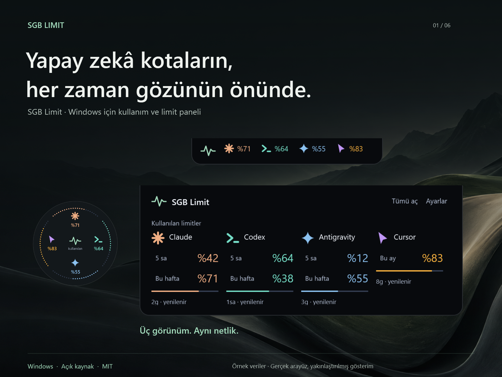

# SGB Limit

Windows için yapay zekâ kullanım ve kota paneli. Desteklenen hesapların bu bilgisayardaki mevcut oturumlarını kullanır. Kullanımı görev çubuğunda, ekran kenarına bağlı Dinamik Ada'da veya dairesel yüzen göstergede takip edebilirsin.

**[Windows x64 için indir](https://github.com/salihbyk/SGB-Limit/releases/latest)** · [Güvenlik](SECURITY.md) · [Katkıda bulun](CONTRIBUTING.md) · [MIT lisansı](LICENSE)



*Örnek veriler; gerçek WPF arayüzü.*

## İndir ve çalıştır

1. [Son sürüm sayfasındaki](https://github.com/salihbyk/SGB-Limit/releases/latest) Windows x64 ZIP paketini indir.
2. ZIP dosyasına sağ tıkla ve **Tümünü ayıkla** seçeneğini kullan.
3. Ayıklanan klasördeki `SGBLimit.exe` dosyasını çalıştır.
4. Ayarlar'dan görünümü seç, seçeneklerini düzenle ve son adımda **Kaydet** düğmesine bas.

Paket .NET 10 çalışma zamanını içerir. Ayrıca .NET kurman gerekmez. Uygulama Windows x64 üzerinde, geliştirme bilgisayarında test edildi. Farklı bilgisayarlar, çoklu ekranlar ve tüm görev çubuğu düzenleri için aynı sonuç garanti edilmez.

Uygulama taşınabilir paket olarak çalışır. Masaüstü veya Başlat menüsünde kullanmak için Windows üzerinden `SGBLimit.exe` dosyasının kısayolunu oluşturabilirsin.

Paket henüz kod imzalı değildir. Windows yayıncıyı doğrulayamayabilir. Sürüm sayfasında SHA-256 özeti varsa indirdiğin dosyayla karşılaştırabilirsin. Bu kontrol dosyanın yayımlanan paketle eşleştiğini gösterir, yazılımın güvenli olduğunu veya yayıncının kimliğini tek başına kanıtlamaz.

## 2.4'te neler var?

- **Alana uyum sağlayan görev çubuğu.** Alan daraldığında önce isimli görünüm küçülür, sonra hesaplar ikon ve yüzdeyle gösterilir. Hesaplar hâlâ sığmıyorsa `+N` kullanılır. Güvenilir alan ölçümü yoksa sistem tepsisi üzerinden erişim sürer.
- **3 veya 5 çubuklu Sinyal.** Çubuklar Kullanılan veya Kalan tercihini izler. Sinyal, dar görev çubuğu yüzdesi ve panel, hesabın bağlayıcı kotasını aynı şekilde esas alır. Küçük oranlar tam çubuğa yuvarlanmaz.
- **Ekran kenarında Dinamik Ada.** Sağ ve sol kenarda üst, orta ve alt olmak üzere altı dikey konum bulunur. Üst ve alt kenarlarda da sol, orta ve sağ konumlar seçilebilir.
- **350 ms açılma geçişi.** Ada genişlerken içerik hafifçe açılır. Fare hareketi veya veri yenilemesi geçişi yarıda tersine çevirebilir. Windows'un hareket azaltma tercihi uygulanır.
- **Üç adımlı görünüm ayarları.** Önce gösterim biçimi, sonra o biçimin seçenekleri, ardından yerleşim ve genel görünüm seçilir. Geri dönmek seçimleri korur. Değişiklikler son adımdaki Kaydet ile uygulanır.
- **Güncel ve eski verinin ayrılması.** Bilinmeyen kota `—` ile gösterilir. Eski okumalar güncel kota gibi sunulmaz.

## Sağlayıcılar ve kota doğruluğu

Kota entegrasyonları Claude, Codex, Antigravity, Grok Bot, Cursor, TRAE ve yapılandırılmış OpenCode Go'yu kapsar. Entegrasyonun çalışması ilgili sağlayıcıya, yerel giriş durumuna ve desteklenen oturum biçimine bağlıdır. Bir uygulamanın bulunması ücretli aboneliğin veya kotanın doğrulandığı anlamına gelmez. Farklı ürünlerin kotaları birleştirilmez.

Antigravity çalışırken güncel kota yerel IDE servisinden okunur. IDE kapalıysa aynı hesaba ait, süresi geçmemiş kayıtlı oturumla desteklenen bulut okuması denenebilir. Okuma yapılamadığında yalnız hesabı doğrulanmış son okuma korunur. Görev çubuğu ve adada `*`, panelde okuma saati ve **güncel değil** etiketi görünür. Bu değer canlı kota değildir. Süresi dolmuş veya reddedilmiş oturumla kesintisiz erişim vaat edilmez.

TRAE desteği uluslararası dolar bazlı plan içindir. Çin, Enterprise ve diğer paketler ayrıca doğrulanmalıdır. Sağlayıcılar API'lerini ve giriş biçimlerini değiştirebilir. Tüm aboneliklerin otomatik bulunması garanti edilmez. Eksik dönem veya yenileme bilgisi için yüzde, tarih ya da kullanım tahmini uydurulmaz.

## Gizlilik

- Uygulama desteklenen yerel oturum dosyalarını yalnız okur. Giriş bilgilerini uygulama ayarlarına kopyalamaz. Her Windows kullanıcısının kendi mevcut oturumu gerekir.
- Kota istekleri ilgili sağlayıcının API'sine veya yerel IDE servisine gider. Uygulama tamamen çevrimdışı çalışmaz.
- Kaynak kodunda ayrı bir telemetri veya analiz gönderimi bulunmuyor. Bu ifade bağımsız bir güvenlik denetimi yapıldığı anlamına gelmez.
- Ayarlar `%APPDATA%\SGBPulse`, kota önbelleği `%LOCALAPPDATA%\SGBPulse` altında tutulur. Önbellek hesap tanımlayıcıları, plan ve kullanım bilgisi içerebilir. Eski klasör adı, mevcut kullanıcı ayarlarını korumak için sürdürülür.
- Gerçek hesap ekranlarını, önbellekleri, giriş dosyalarını ve erişim anahtarlarını issue veya pull request'e ekleme. Güvenlik açığı için [özel bildirim yolunu](SECURITY.md) kullan.

## Kaynaktan çalıştır

Windows ve **.NET 10 SDK** gerekir. Son yerel doğrulamada SDK 10.0.401 kullanıldı.

```powershell
git clone https://github.com/salihbyk/SGB-Limit.git
cd SGB-Limit
dotnet restore .\TokenTray.slnx
dotnet test .\tests\TokenTray.Tests\TokenTray.Tests.csproj -c Release
dotnet run --project .\src\TokenTray\TokenTray.csproj
```

Normal geliştirme sürümünü açmadan önce çalışan SGB Limit'ten çık. Uygulama tek örnek çalışır.

Windows x64 için kendi çalışma zamanını içeren yayın çıktısı:

```powershell
dotnet publish .\src\TokenTray\TokenTray.csproj -c Release -r win-x64 -o .\artifacts\win-x64
```

Dağıtım paketine `LICENSE`, `THIRD_PARTY_NOTICES.md` ve kullanılan .NET çalışma zamanının lisans ve üçüncü taraf bildirimleri eklenmelidir. Yayın çıktısına kişisel ayar veya hesap dosyası ekleme.

`--verify <tam-klasör-yolu>` sentetik verilerle WPF çizimlerini ve görünüm kontrollerini üretir. Hazır CI yapılandırması bu yolu kullanır; ilk yayın oturumunda iş akışı yazma yetkisi olmadığı için henüz etkin değildir (bkz. docs/automation/windows-ci.yml). Gerçek masaüstü, görev çubuğu ve fare etkileşimi kontrolleri [katkı rehberinde](CONTRIBUTING.md) açıklanır. CI sonucu, başka bilgisayarlarda veya canlı sağlayıcı oturumlarında doğrulama yapıldığı anlamına gelmez.

## Kaynak ve lisans

SGB Limit, [Emre Canik'in TokenTray projesinden](https://github.com/emrecengdev/tokentray) türetilmiştir ve [MIT lisansını](LICENSE) korur. `TokenTray.slnx`, `src/TokenTray.Core`, `src/TokenTray` ve bazı dahili ad alanları bu kökeni taşır. Uygulamanın kullanıcıya görünen adı SGB Limit, çalıştırılabilir dosyası `SGBLimit.exe`'dir.

[Üçüncü taraf bildirimleri](THIRD_PARTY_NOTICES.md) kaynak kökenini, çalışma zamanı bildirimlerini ve marka kullanımını açıklar. Bu proje, desteklenen sağlayıcıların resmî ürünü değildir.

## English summary

SGB Limit 2.4 is a native Windows WPF quota monitor for supported AI accounts. Choose an adaptive taskbar display, an edge-docked Dynamic Island or a circular floating widget. Three/five Signal bars follow the same used/remaining quota as the details panel. Unknown quotas display `—`, and historical readings are marked stale.

[Download the Windows x64 package](https://github.com/salihbyk/SGB-Limit/releases/latest), extract it and run `SGBLimit.exe`. The self-contained package includes .NET 10 and is currently unsigned. Testing on the development PC does not establish compatibility with every Windows setup.

Existing local credentials are read only. Requests go to the respective provider API or local IDE service. Local caches can contain account information. No separate telemetry sender is present in the source, and no independent security audit is claimed. Derived from [TokenTray](https://github.com/emrecengdev/tokentray), distributed under MIT with upstream attribution preserved.
