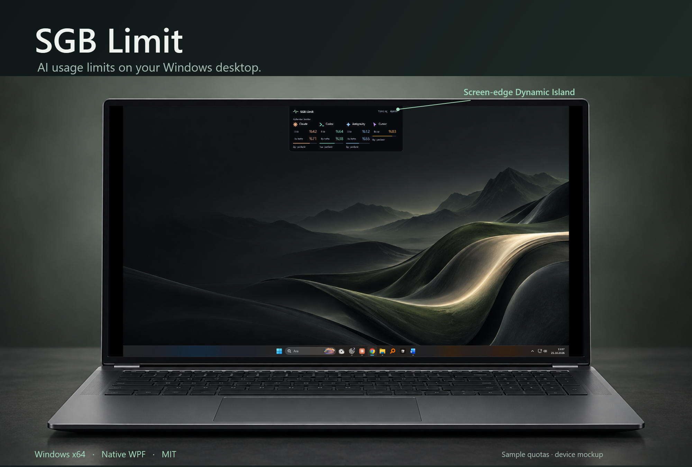
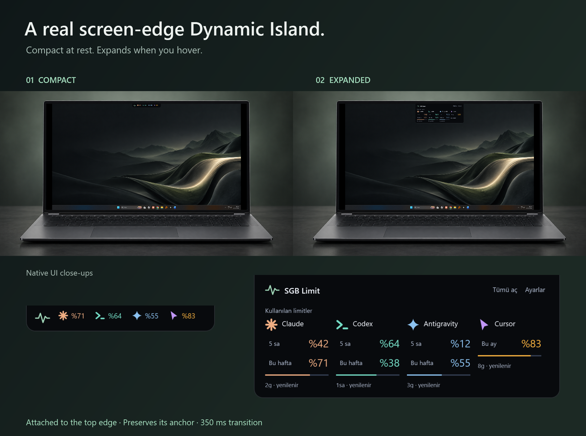
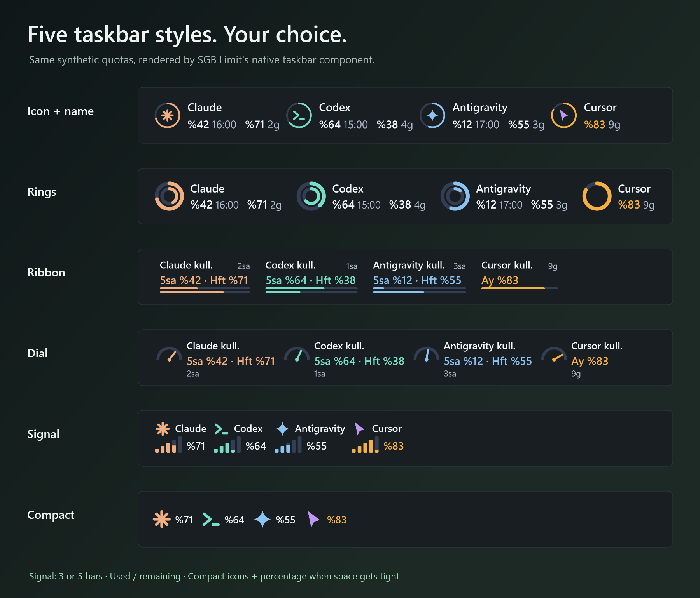
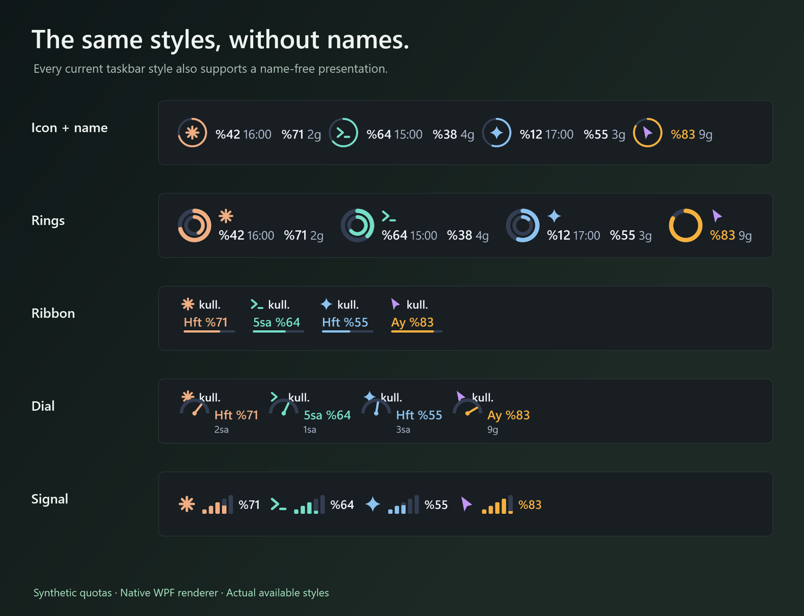
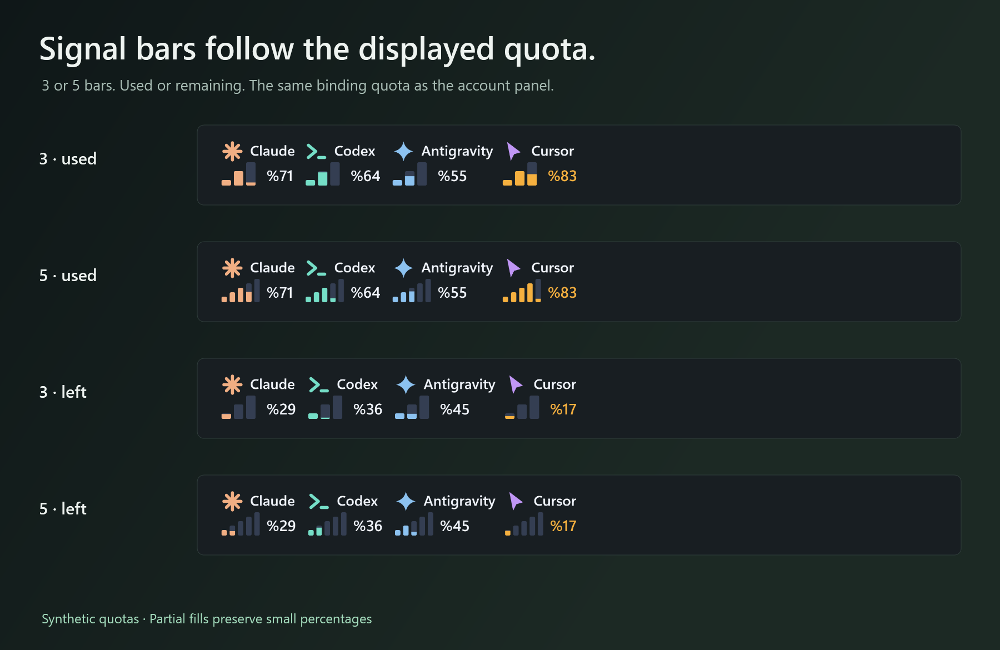
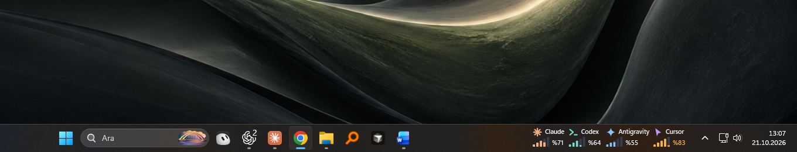
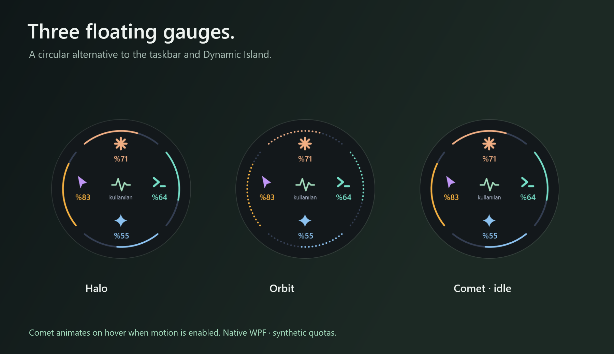
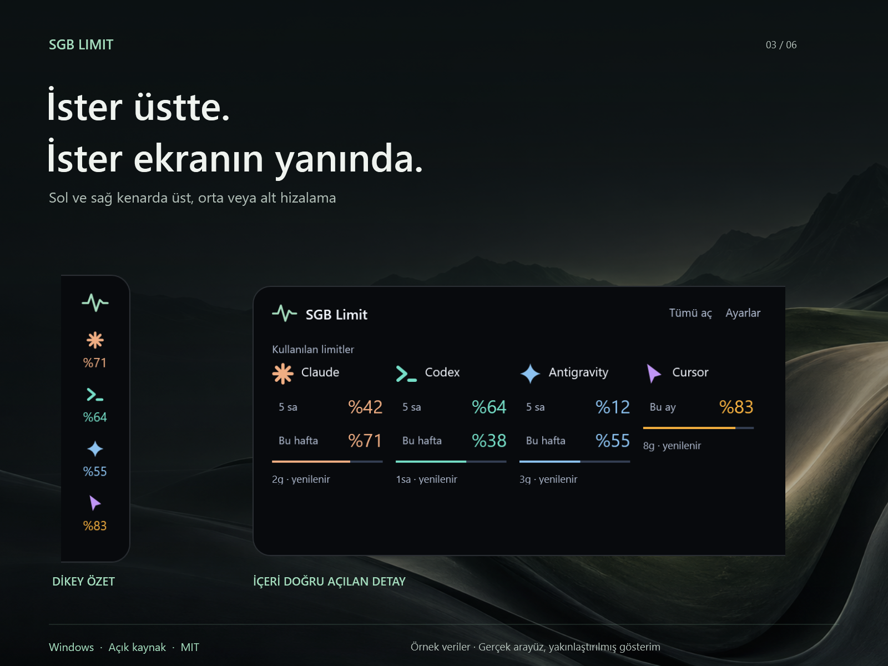

# SGB Limit

An open-source Windows quota tracker for **Claude Code, Codex, Antigravity** and other supported AI accounts. Keep usage limits in view with a native WPF Dynamic Island, an adaptive taskbar monitor or a circular floating widget.

[](LICENSE)


[](https://github.com/salihbyk/SGB-Limit/releases/latest)

**[Download for Windows x64](https://github.com/salihbyk/SGB-Limit/releases/latest)** · **[Türkçe](README.tr.md)** · [Contributing](CONTRIBUTING.md) · [Security](SECURITY.md)

<a href="docs/images/laptop-hero.png"></a>

*Native WPF interface with synthetic account and quota data. The laptop is a presentation mockup, not a hardware compatibility claim.*

## Download and run

1. Download the Windows x64 ZIP from the [latest release](https://github.com/salihbyk/SGB-Limit/releases/latest).
2. Choose **Extract all**, then run `SGBLimit.exe` from the extracted folder.
3. Open Settings, choose a display mode and apply your choices with **Save** on the final step.

The portable package includes the .NET 10 runtime. No separate .NET installation is required. You can create a desktop or Start menu shortcut through Windows. The current interface is in Turkish.

**The executable is unsigned.** Windows may show an unverified-publisher warning. A published SHA-256 hash can confirm that a download matches the release file, but does not establish publisher identity or software safety. Testing has been performed on the development Windows x64 PC. Other PCs, multi-monitor setups and taskbar configurations need their own checks.

## A Dynamic Island for Windows

Dock the island to a screen edge. Hover to expand from a compact overview into account names and quotas, then click an account for details. The 350 ms transition supports direction changes and Windows reduced-motion preferences.

<a href="docs/images/dynamic-island-states.png"></a>

*Compact and expanded native interface, shown with sample data in a laptop mockup.*

## A taskbar monitor that fits the available space

Choose **Identity, Rings, Ribbon, Dial or Signal**. As space narrows, named rows become compact icons with percentages. Overflow uses `+N`. If taskbar space cannot be measured reliably, the tray remains available.

<a href="docs/images/taskbar-styles.png"></a>

Signal has three or five bars. Its used/remaining display follows the same binding quota as the details panel, including small fractions. Missing readings do not turn into a full signal.

<details>
<summary>Compare the five styles without names, and all four Signal options</summary>





</details>

<a href="docs/images/taskbar-desktop.png"></a>

*Native taskbar placement with synthetic readings. Desktop behavior can vary with Windows configuration.*

## Three floating styles

**Halo, Orbit and Comet** show each provider in its own circular sector. Open the panel for period limits, reset information and the plan reported by the provider.

<a href="docs/images/floating-styles.png"></a>

*Native floating widgets with synthetic readings.*

## Side docks and step-by-step settings

The Dynamic Island offers six vertical docks: top, center and bottom on either side. Top and bottom edges also support left, center and right positions. Appearance settings progress through display mode, its options and placement. Going back preserves the draft. Only the final Save applies it.

<a href="docs/images/vertical.png"></a>

*Native side-dock examples with synthetic data.*

## Supported accounts and honest readings

Quota integrations cover **Claude, Codex, Antigravity, Grok Bot, Cursor, TRAE and configured OpenCode Go**. Each depends on supported local login formats and provider services. Detecting an installed app does not prove a paid plan. Different products' allowances are kept separate.

Unknown quotas show `—`. Historical readings are marked stale rather than presented as live limits. When Antigravity is closed, a valid stored session for the same verified account may allow a cloud read. Otherwise, the last verified reading is marked with `*` in compact views and its read time in the panel. Expired or rejected sessions do not guarantee continued access. TRAE support targets international dollar-based plans, not every region or plan type.

## Privacy

Supported local credentials are **read only** and are not copied into app settings. Requests go to the respective provider API or local IDE service. This is not an offline-only application.

Settings live in `%APPDATA%\SGBPulse`, with quota caches in `%LOCALAPPDATA%\SGBPulse`. These legacy folder names preserve existing settings. Caches can contain account identifiers, plan and usage information. No separate telemetry sender is present in the source, and no independent security audit is claimed. Never attach real credentials, caches or account screenshots to issues. See [Security](SECURITY.md).

## Questions about AI usage limits on Windows

### How do I monitor Claude Code and Codex usage?

Sign in to a supported local CLI or desktop application, then open SGB Limit. It displays the quota windows that the provider actually reports for that account. An installed application alone does not prove a paid plan or a valid session.

### Can I see remaining quota instead of usage?

Yes. Choose used or remaining in the panel or appearance settings. Signal bars and the compact taskbar percentage follow the same binding quota as the account panel.

### Does the Dynamic Island work away from the top edge?

Yes. Choose a horizontal top/bottom dock or one of six vertical side docks. It is a native Windows overlay; a laptop notch or special display is not required.

### Will Antigravity quota stay live when the IDE closes?

A supported, unexpired stored session for the same account can permit a cloud read. Otherwise the identified last reading is explicitly marked stale. Expired sessions are not presented as fresh quotas.

## Build from source

Requires Windows and the **.NET 10 SDK**. Exit any running SGB Limit instance before starting a normal development build.

```powershell
git clone https://github.com/salihbyk/SGB-Limit.git
cd SGB-Limit
dotnet restore .\TokenTray.slnx
dotnet test .\tests\TokenTray.Tests\TokenTray.Tests.csproj -c Release
dotnet run --project .\src\TokenTray\TokenTray.csproj
```

For a self-contained Windows x64 build:

```powershell
dotnet publish .\src\TokenTray\TokenTray.csproj -c Release -r win-x64 -o .\artifacts\win-x64
```

The [contribution guide](CONTRIBUTING.md) covers synthetic WPF checks and native desktop probes. A CI configuration is provided in [docs/automation/windows-ci.yml](docs/automation/windows-ci.yml), but is not active as a GitHub workflow.

## Built on TokenTray

SGB Limit is an MIT-licensed derivative of **[TokenTray by Emre Canik](https://github.com/emrecengdev/tokentray)**. Its provider integrations, polling and quota core, original taskbar renderers and geometric provider marks build on that upstream work. SGB Limit work includes the Dynamic Island, a circular floating redesign, adaptive taskbar behavior, Signal display, Turkish panels and progressive settings, alongside integration and stale-reading refinements.

The original copyright and MIT notice are preserved in [LICENSE](LICENSE). Internal `TokenTray` project and namespace names retain that history. See [Third-party notices](THIRD_PARTY_NOTICES.md) for runtime and artwork details. This independent project does not imply endorsement by the upstream author or the supported providers.
