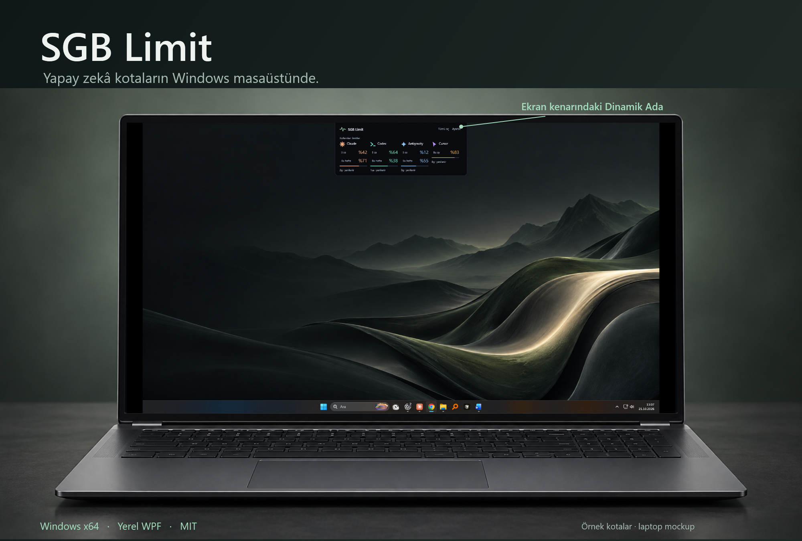

# SGB Limit

**Claude Code, Codex, Antigravity** ve desteklenen diğer yapay zekâ hesapları için açık kaynak Windows kullanım ve kota paneli. Kullanımı yerel WPF arayüzüyle Dinamik Ada'da, görev çubuğunda veya dairesel yüzen göstergede takip edebilirsin.

[](LICENSE)


[](https://github.com/salihbyk/SGB-Limit/releases/latest)

**[Windows x64 için indir](https://github.com/salihbyk/SGB-Limit/releases/latest)** · **[English](README.md)** · [Katkıda bulun](CONTRIBUTING.md) · [Güvenlik](SECURITY.md)

<a href="docs/images/laptop-hero-tr.png"></a>

*Örnek hesap ve kota verileriyle gerçek WPF arayüzü. Dizüstü bilgisayar görseli sunum amaçlı bir mockup'tır, belirli bir donanımda test edildiği anlamına gelmez.*

## İndir ve çalıştır

1. [Son sürüm sayfasından](https://github.com/salihbyk/SGB-Limit/releases/latest) Windows x64 ZIP paketini indir.
2. ZIP dosyasına sağ tıkla ve **Tümünü ayıkla** seçeneğini kullan.
3. Ayıklanan klasördeki `SGBLimit.exe` dosyasını çalıştır.
4. Ayarlar'dan gösterim biçimini ve seçeneklerini belirle. Son adımda **Kaydet** düğmesine bas.

Paket .NET 10 çalışma zamanını içerir. Ayrıca .NET kurman gerekmez. Taşınabilir paket olarak çalışır. Masaüstü veya Başlat menüsünde kullanmak için Windows üzerinden `SGBLimit.exe` dosyasının kısayolunu oluşturabilirsin. Mevcut arayüz Türkçedir.

Paket henüz kod imzalı değildir. Windows yayıncıyı doğrulayamayabilir. Sürüm sayfasındaki SHA-256 özetini indirdiğin dosyayla karşılaştırmak dosyanın yayımlanan paketle eşleştiğini gösterir. Bu kontrol, yazılımın güvenli olduğunu veya yayıncının kimliğini tek başına kanıtlamaz.

Uygulama geliştirme bilgisayarında Windows x64 üzerinde test edildi. Başka bilgisayarlar, çoklu ekranlar ve farklı görev çubuğu düzenleri ayrıca kontrol edilmelidir.

## Dinamik Ada

Ada'yı ekran kenarına yerleştir. Fareyle üzerine geldiğinde hesap adları ve kotaları açılır. Hesaba tıklayarak ayrıntıları görebilirsin. 350 ms geçiş sırasında yön değiştirilebilir ve Windows'un hareket azaltma tercihi uygulanır.

<a href="docs/images/dynamic-island-states.png"></a>

*Kapalı ve açık gerçek WPF arayüzü, örnek verilerle sunum amaçlı bir bilgisayar maketinde gösteriliyor.*

## Alana uyum sağlayan görev çubuğu

**Identity, Rings, Ribbon, Dial veya Sinyal** görünümünü seçebilirsin. Alan daraldığında isimli görünüm küçülür, ardından hesaplar ikon ve yüzdeyle gösterilir. Hesaplar hâlâ sığmıyorsa `+N` kullanılır. Güvenilir alan ölçümü yoksa sistem tepsisi üzerinden erişim sürer.

<a href="docs/images/taskbar-styles.png"></a>

Sinyal göstergesinde üç veya beş çubuk seçilebilir. Çubuklar Kullanılan veya Kalan tercihini izler. Sinyal, dar görev çubuğu yüzdesi ve ayrıntı paneli aynı bağlayıcı kotayı esas alır. Küçük oranlar tam çubuğa yuvarlanmaz. Okunamayan kota dolu sinyal olarak gösterilmez.

<a href="docs/images/taskbar-desktop.png"></a>

*Gerçek Windows görev çubuğunda sentetik okumalar. Masaüstü davranışı Windows ayarlarına göre değişebilir.*

<details>
<summary>İsimsiz stilleri ve 3/5 çubuklu Kullanılan/Kalan örneklerini göster</summary>


</details>

## Üç dairesel yüzen stil

**Halo, Orbit ve Comet**, her sağlayıcıyı kendi renkli çevresel alanında gösterir. Panelden dönem kotalarını, yenileme bilgisini ve sağlayıcının bildirdiği planı açabilirsin.

<a href="docs/images/floating-styles.png"></a>

*Gerçek WPF göstergeleri, örnek kota verileri.*

## Yan yerleşimler ve üç adımlı ayarlar

Dinamik Ada sağ ve sol kenarda üst, orta ve alt olmak üzere altı dikey konuma yerleşebilir. Üst ve alt kenarlarda da sol, orta ve sağ konumlar seçilebilir.

<a href="docs/images/vertical.png"></a>

*Gerçek yan yerleşim arayüzü, örnek veriler.*

Görünüm ayarları üç adımda ilerler. Önce gösterim biçimi, sonra o biçimin seçenekleri, ardından yerleşim ve genel görünüm seçilir. Geri dönmek taslak seçimleri korur. Değişiklikler son adımdaki Kaydet ile uygulanır.

## Sağlayıcılar ve kota doğruluğu

Kota entegrasyonları **Claude, Codex, Antigravity, Grok Bot, Cursor, TRAE ve yapılandırılmış OpenCode Go**'yu kapsar. Çalışmaları desteklenen yerel giriş biçimlerine ve sağlayıcı servislerine bağlıdır. Bir uygulamanın bulunması ücretli aboneliğin veya kotanın doğrulandığı anlamına gelmez. Farklı ürünlerin kotaları birleştirilmez. Tüm aboneliklerin otomatik bulunması garanti edilmez.

Bilinmeyen kota `—` ile gösterilir. Eski okumalar güncel kota gibi sunulmaz. Eksik dönem veya yenileme bilgisi için yüzde, tarih ya da kullanım tahmini uydurulmaz.

Antigravity çalışırken güncel kota yerel IDE servisinden okunur. IDE kapalıysa aynı hesaba ait, süresi geçmemiş kayıtlı oturumla desteklenen bulut okuması denenebilir. Okuma yapılamadığında yalnız hesabı doğrulanmış son okuma korunur. Görev çubuğu ve adada `*`, panelde okuma saati ve **güncel değil** etiketi görünür. Bu değer canlı kota değildir. Süresi dolmuş veya reddedilmiş oturumla kesintisiz erişim vaat edilmez.

TRAE desteği uluslararası dolar bazlı plan içindir. Çin, Enterprise ve diğer paketler ayrıca doğrulanmalıdır. Sağlayıcılar API'lerini ve giriş biçimlerini değiştirebilir.

## Gizlilik

- Uygulama desteklenen yerel oturum dosyalarını yalnız okur. Giriş bilgilerini uygulama ayarlarına kopyalamaz. Her Windows kullanıcısının kendi mevcut oturumu gerekir.
- Kota istekleri ilgili sağlayıcının API'sine veya yerel IDE servisine gider. Uygulama tamamen çevrimdışı çalışmaz.
- Kaynak kodunda ayrı bir telemetri veya analiz gönderimi bulunmuyor. Bağımsız güvenlik denetimi yapıldığı iddia edilmiyor.
- Ayarlar `%APPDATA%\SGBPulse`, kota önbelleği `%LOCALAPPDATA%\SGBPulse` altında tutulur. Önbellek hesap tanımlayıcıları, plan ve kullanım bilgisi içerebilir. Eski klasör adları mevcut kullanıcı ayarlarını korur.
- Gerçek hesap ekranlarını, önbellekleri, giriş dosyalarını ve erişim anahtarlarını issue veya pull request'e ekleme. Güvenlik açığı için [özel bildirim yolunu](SECURITY.md) kullan.

## Kaynaktan çalıştır

Windows ve **.NET 10 SDK** gerekir. Normal geliştirme sürümünü açmadan önce çalışan SGB Limit'ten çık. Uygulama tek örnek çalışır.

```powershell
git clone https://github.com/salihbyk/SGB-Limit.git
cd SGB-Limit
dotnet restore .\TokenTray.slnx
dotnet test .\tests\TokenTray.Tests\TokenTray.Tests.csproj -c Release
dotnet run --project .\src\TokenTray\TokenTray.csproj
```

Windows x64 için kendi çalışma zamanını içeren yayın çıktısı:

```powershell
dotnet publish .\src\TokenTray\TokenTray.csproj -c Release -r win-x64 -o .\artifacts\win-x64
```

Dağıtım paketine `LICENSE`, `THIRD_PARTY_NOTICES.md` ve .NET çalışma zamanının lisans ve üçüncü taraf bildirimleri eklenmelidir. Kişisel ayar veya hesap dosyası ekleme.

`--verify <tam-klasör-yolu>` kişisel hesapları okumadan örnek verilerle WPF çizimlerini ve görünüm kontrollerini üretir. Gerçek masaüstü, görev çubuğu ve fare etkileşimi kontrolleri [katkı rehberinde](CONTRIBUTING.md) açıklanır. Hazır [Windows CI yapılandırması](docs/automation/windows-ci.yml) depoda bulunur ancak GitHub iş akışı olarak henüz etkin değildir. Yerel doğrulama, GitHub CI sonucu veya tüm bilgisayarlarda uyumluluk kanıtı sayılmaz.

## TokenTray üzerine geliştirildi

SGB Limit, **[Emre Canik'in TokenTray projesinden](https://github.com/emrecengdev/tokentray)** türetilmiştir ve MIT lisansını korur. Sağlayıcı entegrasyonları, periyodik sorgulama ve kota çekirdeği, özgün görev çubuğu çizimleri ve geometrik sağlayıcı simgeleri kaynak projeye dayanır.

SGB Limit çalışmaları Dinamik Ada'yı, dairesel yüzen görünümün yeniden tasarımını, alana uyum sağlayan görev çubuğunu, Sinyal göstergesini, Türkçe panelleri ve aşamalı ayarları kapsar. Entegrasyonlar ile eski okumaların gösteriminde de düzenlemeler içerir.

Özgün telif ve MIT bildirimi [LICENSE](LICENSE) içinde korunur. `TokenTray.slnx`, `src/TokenTray.Core`, `src/TokenTray` ve bazı dahili ad alanları bu kökeni taşır. Kullanıcıya görünen ad SGB Limit, çalıştırılabilir dosya `SGBLimit.exe`'dir. Çalışma zamanı ve görsel bildirimleri [THIRD_PARTY_NOTICES.md](THIRD_PARTY_NOTICES.md) içindedir. Bu bağımsız proje, TokenTray yazarı veya sağlayıcılarla resmî ilişki ya da onların onayını ifade etmez.
